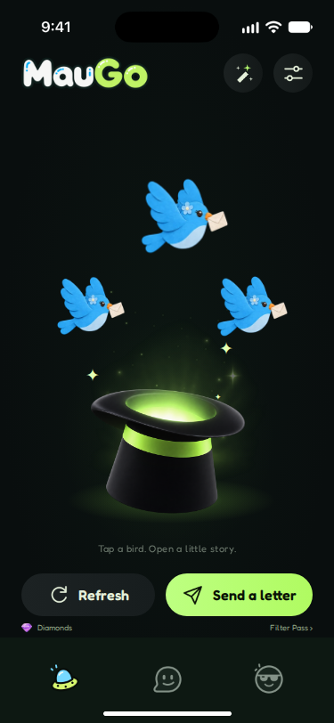
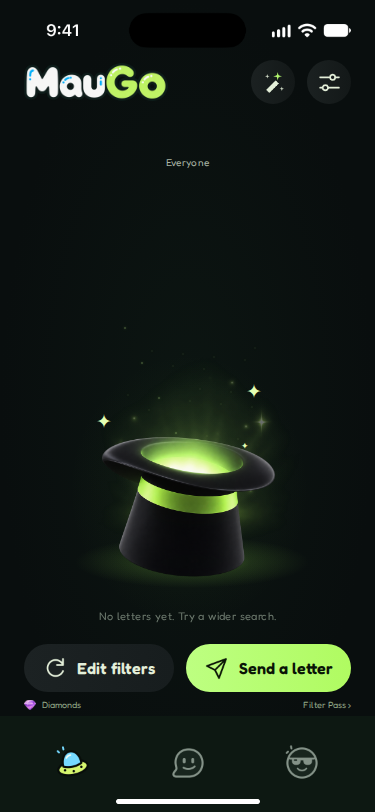
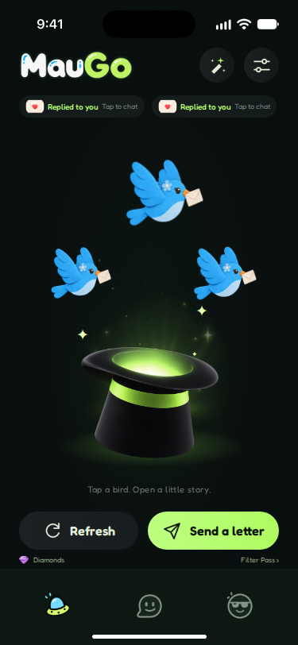

# R06 Discover 验收

分支 `codex/r06-discover`；基线 `4570d5b`。设计仅来自 `/root/maugo-figma/maugo-file-full.json`，版本 `2421258509127695554`，复核节点 `35:3533` / `35:3647` / `35:3757`。未调用 Figma API、未导出/修改素材。默认鸟款维持 female-1（蓝色），紫/蓝选择待 Smith。

## 测量与 H1–H20 证据

坐标均为 375×812 内的 x,y,w,h。目标值由 JSON 的 absoluteBoundingBox 减去状态根坐标得到：ready=(40,1164)，empty=(455,1164)，response=(870,1164)。基线值来自 HEAD 源码的临时副本 `/tmp/r06-baseline/client`，独立 Vite 5187，Chromium 375×812、reduced-motion，真实测试账户和 discovery 数据；不是根据任务描述填表。HTML 元素使用 Playwright boundingBox；SVG 曲线使用 getBBox 对照 Figma 几何边界，Chromium 的 Playwright SVG boundingBox 另外包含贝塞尔控制点/描边，不能把两者当作同一量。下表小数作展示舍入；测试容差 ≤1px。基线常态轨迹 opacity=.65，reduced-motion 下实测=.45。

| H | JSON 节点 / 目标 | 基线实测差距 | 实现与证据 |
|---|---|---|---|
| H1 | 35:3533/3647/3757，0,0,375,812；090E0E + 102017@40% 径向层 | 尺寸正确，background-image=none | 三态 box、背景色及完整径向背景断言 |
| H2 | 35:3535，69,354,240,271；98FA48@12% / 68A734@4% / 透明 | 64,369,248,242，单层 80DA35@11% | `.aura` box 与三段径向背景断言 |
| H3 | 35:3536，75,536,234,52；radius26；ADF959@44% / 75B140@18% | 无 | `.hat-glow` box / radius / gradient 断言 |
| H4 | 35:3538，147,454,85,21；radius10.5；D3FF80，opacity .4 | 无 | `.hat-highlight` box / radius / color / opacity 断言 |
| H5 | 35:3537，70,319,242,244，opacity .4 | 75,390,225,210，opacity .22 | `.scene-mist` box / opacity 断言 |
| H6 | 35:3539，0,0,375,812，particles image | 未使用 | 接现有 home-particles；box 断言，截图可见 |
| H7 | 35:3541/3543/3545，51.8,296.8,92.4²；142.6,182.6,118.8²；231.48,296.48,95.04² | 40,294,92²；145,183,100²；222,294,92² | 三鸟 box；motion-off/reduced-motion frame1；开启动效 sprite-loop / steps(6) / transform=none 断言 |
| H8 | 35:3548/3550/3552，96,409,15.07,23；246,379,15.07,23；240.5705,441,8,11；19/19/9px，E5FFB3 | 一串文本，94,373,190.766,23；D5FFAD，letter-spacing13 | 三个独立 ✦，box / font-size / color 断言 |
| H9 | 35:3555–3560，静止 path opacity0；D6FF9C .85px；AAFF68 5px / blur6 | 轨迹常显 .65；reduced-motion .45 | 静止与关闭动效透明；stroke / width / blur 断言；沿用离线原型三路径及 delay .62/.41/.83s、duration1.69/2.07/1.73s，飞行后淡出；UI 指令按原型 smooth(u) 与 exp(-t/1100) 公式绘制和淡出，保留暂停/减弱动效 |
| H10 | 35:3561/3562，99,435,178,143；无阴影 | box正确；drop-shadow(0 8px 7px black@40%)；idle hat 动画 | box / filter=none / idle animation=none 断言；refreshing 快摆保留 |
| H11 | 35:3563/3564，20,608,335,16；400 11/16；tracking .4；849284；opacity .8 | box/font/color正确；tracking normal、opacity1 | box / color / font-size / line-height / tracking / opacity 断言 |
| H12 | 35:3568，24.113,644,150,48；radius30；横向 secondary；600 16/22；gap10 | 24,644,150.406,48；radius24；display:grid导致上下排；14/400；gap8 | `.ui-button--secondary`；box、flex、font、color、radius、完整gradient、24px图标 y656 断言 |
| H13 | 35:3574，186.113,644,165,48；radius30；横向 primary；600 16/22 | 186.406,644,164.594,48；radius24；110deg；14/500 | `.ui-button`；与 H12 同组断言 |
| H14 | 35:3567，gap12 | 实测按钮间12 | 保持；按钮 box 与容器 gap12 |
| H15 | Smith 2026-11-14 保留决定，24,695,327,20；9px | 位置正确 | Diamonds / Filter Pass 功能、位置保留；规则仅迁至 pages/home.css，颜色 token；box / font 断言 |
| H16 | 35:3619/3621/3622/3626，字标24,63.203,144,37.594；按钮251/307,60,44²；图标25² | 几何正确；底rgba(255,255,255,.05)，radius50% | `.ui-icon-button`；字标/按钮/图标 box，radius22、完整gradient断言 |
| H17 | R05，nav0,716,375,96；三图42² | 已正确 | 不改导航模板及规则；R05 原几何/样式回归 |
| H18 | status0,0,375,57.828；indicator115.5,799,144,5 | R05后已正确，并非任务背景中的60px | 保留 --status-height 和 R05 横条；R06 status box + R05 indicator断言 |
| H19 | 35:3672/3675/3676/3683；无鸟；新提示；摘要24,156,327,12，10/12.1 tracking.3 A9B5A5；按钮 Edit filters | 无摘要；旧提示；Refresh | 新英韩提示、真实条件摘要、较长文案单行；空态 box/color/tracking/text 断言；后端不支持80–90，未伪造条件；按钮行为保持原 Refresh，待 Smith |
| H20 | 35:3793/3799，24,120,157.656,28；第二项190.656,120；radius18；202827@50%；gap9 | 单项20,8,110.063,47，radius20，B5FA70@9.4%，两行 | 胶囊固定157.656×28、单行；box/radius/bg/gap/nowrap断言；回应条仍使用真实 responses |

所有首页场景规则集中到 `src/styles/pages/home.css`。HomeFlow 保留旧 home.css 引用以加载 R07/R08 弹层；legacy-1 不变，legacy-2 仅删入口行。`script setup` 仅新增轨迹 UI 指令 import 以联动 SVG；原有业务脚本及弹层模板逐字比较基线一致，main.ts 的 tokens→base→components 顺序未变。按钮与图标按钮外观仍只由 components.css 定义，页面仅给坐标和尺寸。

### 改后浏览器读数

以下为最终新增 Playwright 用例附带的 computed-styles-and-geometry 读数（英文、关闭动效；显示至3位小数）。回应态两项分别有独立坐标断言，表中同类元素记录最后一项。

| 状态 | 元素 | x,y,w,h | 字体 size/weight/line-height | radius |
|---|---|---|---|---|---|
| home-ready | home-wordmark | 24,63.188,144,37.594 | 16px/400/normal | 0px |
| home-ready | magic | 251,60,44,44 | 16px/400/normal | 22px |
| home-ready | settings | 307,60,44,44 | 16px/400/normal | 22px |
| home-ready | aura | 69,354,240,271 | 16px/400/normal | 0px |
| home-ready | hat-glow | 75,536,234,52 | 16px/400/normal | 26px |
| home-ready | hat-highlight | 147,454,85,21 | 16px/400/normal | 10.5px |
| home-ready | scene-particles | 0,0,375,812 | 16px/400/normal | 0px |
| home-ready | scene-mist | 70,319,242,244 | 16px/400/normal | 0px |
| home-ready | magic-spark spark-one | 96,409,15.062,23 | 19px/400/22.99px | 0px |
| home-ready | magic-spark spark-two | 246,379,15.062,23 | 19px/400/22.99px | 0px |
| home-ready | magic-spark spark-three | 240.562,441,8,11 | 9px/400/10.89px | 0px |
| home-ready | letter-bird | 231.469,296.469,95.031,95.031 | 16px/400/normal | 0px |
| home-ready | hat | 99,435,178,143 | 16px/400/normal | 0px |
| home-ready | scene-hint | 20,608,335,16 | 11px/400/16px | 0px |
| home-ready | economy-actions | 24,695,327,20 | 16px/400/normal | 0px |
| home-ready | refresh | 24.109,644,150,48 | 16px/600/22px | 30px |
| home-ready | compose | 186.109,644,165,48 | 16px/600/22px | 30px |
| home-empty | home-wordmark | 24,63.188,144,37.594 | 16px/400/normal | 0px |
| home-empty | magic | 251,60,44,44 | 16px/400/normal | 22px |
| home-empty | settings | 307,60,44,44 | 16px/400/normal | 22px |
| home-empty | aura | 69,354,240,271 | 16px/400/normal | 0px |
| home-empty | hat-glow | 75,536,234,52 | 16px/400/normal | 26px |
| home-empty | hat-highlight | 147,454,85,21 | 16px/400/normal | 10.5px |
| home-empty | scene-particles | 0,0,375,812 | 16px/400/normal | 0px |
| home-empty | scene-mist | 70,319,242,244 | 16px/400/normal | 0px |
| home-empty | magic-spark spark-one | 96,409,15.062,23 | 19px/400/22.99px | 0px |
| home-empty | magic-spark spark-two | 246,379,15.062,23 | 19px/400/22.99px | 0px |
| home-empty | magic-spark spark-three | 240.562,441,8,11 | 9px/400/10.89px | 0px |
| home-empty | hat | 99,435,178,143 | 16px/400/normal | 0px |
| home-empty | filter-summary | 24,156,327,12 | 10px/400/12.1px | 0px |
| home-empty | scene-hint | 20,608,335,16 | 11px/400/16px | 0px |
| home-empty | economy-actions | 24,695,327,20 | 16px/400/normal | 0px |
| home-empty | refresh | 24.109,644,150,48 | 16px/600/22px | 30px |
| home-empty | compose | 186.109,644,165,48 | 16px/600/22px | 30px |
| home-response | home-wordmark | 24,63.188,144,37.594 | 16px/400/normal | 0px |
| home-response | magic | 251,60,44,44 | 16px/400/normal | 22px |
| home-response | settings | 307,60,44,44 | 16px/400/normal | 22px |
| home-response | response-capsule | 190.641,120,157.641,28 | 10px/400/12.1px | 18px |
| home-response | aura | 69,354,240,271 | 16px/400/normal | 0px |
| home-response | hat-glow | 75,536,234,52 | 16px/400/normal | 26px |
| home-response | hat-highlight | 147,454,85,21 | 16px/400/normal | 10.5px |
| home-response | scene-particles | 0,0,375,812 | 16px/400/normal | 0px |
| home-response | scene-mist | 70,319,242,244 | 16px/400/normal | 0px |
| home-response | magic-spark spark-one | 96,409,15.062,23 | 19px/400/22.99px | 0px |
| home-response | magic-spark spark-two | 246,379,15.062,23 | 19px/400/22.99px | 0px |
| home-response | magic-spark spark-three | 240.562,441,8,11 | 9px/400/10.89px | 0px |
| home-response | letter-bird | 231.469,296.469,95.031,95.031 | 16px/400/normal | 0px |
| home-response | hat | 99,435,178,143 | 16px/400/normal | 0px |
| home-response | scene-hint | 20,608,335,16 | 11px/400/16px | 0px |
| home-response | economy-actions | 24,695,327,20 | 16px/400/normal | 0px |
| home-response | refresh | 24.109,644,150,48 | 16px/600/22px | 30px |
| home-response | compose | 186.109,644,165,48 | 16px/600/22px | 30px |

## 实现截图

均为英文、375×812、默认蓝鸟、关闭动效的实现截图。不是 Figma 导出或并排对照。







**A4 并排图与差异比例待 R01/R04 恢复后补。** 3x 图片清晰度待 R03（限流），本次路径与文件未换。

## 渐变 token 跟进清单

使用当前 R02 名称 `--grad-primary`、`--grad-secondary`、`--grad-icon-btn`、`--bg-scene-glow`。未使用 `--grad-icon-btn-horizontal`、各 height 变体或 `--grad-card`。额外补入 JSON 原值缺失的 `--home-aura`、`--home-hat-glow` 径向层，以及首页光斑、轨迹、摘要、回应条、入口颜色和字体 token；没有改名/删除已有 R02 token。R02 修复合入时复核这六个渐变引用。

## A1–A8

| 验收 | 结果 | 证据 / 限制 |
|---|---|---|
| A1 构建 | 通过 | 最终 npm run build，素材343张校验、vue-tsc、Vite全通过，exit 0 |
| A2 几何 | 通过 | R06三态关键元素均≤1px；按钮、三鸟、帽子、光效、页头、提示语、回应条两项及三条轨迹；SVG getBBox 的语义区别见上 |
| A3 样式 | 通过 | 三态计算样式断言与读数：渐变、颜色、圆角、字号/字重/行高、字距、透明度及帽子无阴影；韩文只验布局 |
| A4 截图对照 | 未通过 / 待 R01/R04 | 已存三张实现截图并按H表人工检查；未提供Figma并排图或差异比例 |
| A5 架构 | 通过（R06迁移范围） | pages/home.css、components.css、base.css、HomeFlow.vue：hex=0、rgb字面量=0、!important=0；页面.device提权前缀=0；四份旧文件首页选择器=0；git diff --check通过 |
| A6 回归 | 未通过 / 既有 D4 三失败待 Smith | 首页1、client2、Inbox6、R05导航1及新增R06三态3全通过；d4共3通过3失败，与R05记录同三项；不改业务逻辑或放宽断言 |
| A7 状态覆盖 | 通过 | 通过原有data-state到达ready/empty/response并截图；seed真实测试账户，测试层整形discovery响应；回应态第二个胶囊由seed信件ID构造fixture，不表示真实新增回应 |
| A8 如实 | 通过 | 外部依赖、设计/后端差异、基线失败均记录；未伪造参考图、差异率、80–90条件或3x素材 |

最终结果分组：

| 文件 | 通过 | 失败 | 跳过 |
|---|---:|---:|---:|
| r06-discover.spec.ts | 3 | 0 | 0 |
| home.spec.ts | 1 | 0 | 0 |
| client.spec.ts | 2 | 0 | 0 |
| inbox.spec.ts | 6 | 0 | 0 |
| r05-shell.spec.ts | 1 | 0 | 3 |
| d4.spec.ts | 3 | 3 | 0 |
| 合计 | 16 | 3 | 3 |

D4 三项与 R05 在281b4bc基线复核的失败一致：editing/avatar 用例的数据桩缺少 avatars 导致 `p.avatars is not iterable`；public profile open 的 follow 状态不一致；public full content 缺少 `25 · Seoul`。本轮隔离回归复现同样失败。R05三项跳过是未实现的 unread badge，与R06无关。扩展Inbox首次运行遇登录步骤超时；未修改4570d5b副本复测通过，最终本分支完整复跑6项全通过，故不将初跑超时冒称基线缺陷。

旧 home.css/legacy/fidelity 中保留的弹层、支付、其他模块仍有历史颜色/important，按明确禁改范围留给R07/R08；A5的“零”不包含这些未迁移规则。轨迹指令只控制SVG展示：原型三条曲线、smooth(u)、.68*exp(-t/1100)、glow系数.55，飞行后6.6秒归零；不移动鸟，不改变请求、筛选、支付或回应业务。

待 Smith / 后续任务：A4待R01/R04；3x清晰度待R03；默认紫/蓝款未定且未改；H19的80–90示例超出现有18–50+筛选能力，当前摘要显示实际条件；空态显示设计的Edit filters，但按“不动逻辑”保留原Refresh动作与aria-label，是否改为打开筛选待Smith；D4数据桩三失败待单独处理。

## 复跑

默认端口空闲时：

```sh
cd client
npm run build
npx playwright test tests/r06-discover.spec.ts tests/home.spec.ts tests/client.spec.ts tests/r05-shell.spec.ts tests/inbox.spec.ts tests/d4.spec.ts --workers=1
```

本机3001已占用。正式隔离回归使用临时 `.r06-run` 副本，仅替换3001→3106，5173→5186，并启动原 auth-server.mjs 创建新测试数据库；测试结束清理临时副本/配置。首次默认配置在沙箱内遇 IPC EPERM；获批后通过本地测试执行权限运行。未停止默认端口已有服务。


临时端口配置复现脚本（在client目录）：

```python
from pathlib import Path
Path('.r06-run').mkdir(exist_ok=True)
for p in Path('tests').iterdir():
    if p.is_file():
        Path('.r06-run', p.name).write_text(p.read_text().replace('3001', '3106'))
s = Path('playwright.config.ts').read_text()
s = s.replace("'./tests'", "'./.r06-run'").replace('tests/auth-server.mjs', '.r06-run/auth-server.mjs')
s = s.replace('3001', '3106').replace('5173', '5186')
Path('r06-run.config.ts').write_text(s)
```

随后运行 `npx playwright test -c r06-run.config.ts --workers=1 r06-discover.spec.ts home.spec.ts client.spec.ts r05-shell.spec.ts inbox.spec.ts d4.spec.ts`。最终验收分组执行：核心回归10通过/3跳过，修正SVG边界读取后的R06三态3通过；D4隔离回归3通过/3失败。截图使用最后一次三态运行的产物。
