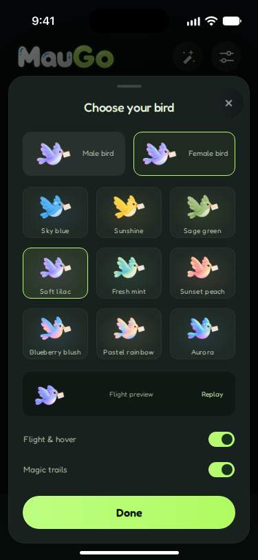
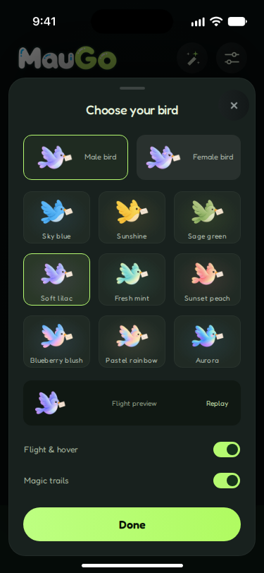
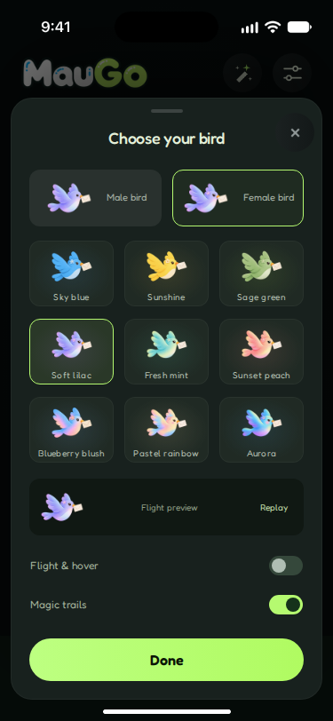

# R07 筛选与信使外观验收

分支 `codex/r07-filter`；唯一设计来源 `/root/maugo-figma/maugo-file-full.json`，版本 `2421258509127695554`。未调用 Figma API，未使用 token，未导出或替换图片。基线 `4f4adc9`。只修改筛选与外观；保留 Diamonds / Filter Pass 入口、Discover 场景、空态 Edit filters/Refresh 文案与动作。script setup 未改。

## 先量：旧代码与目标差距

坐标均相对于 375×812 画框。以下旧值来自改动前源码（不是伪造的浏览器实测）；后附六个节点子树的逐元素原始测量，含位置、尺寸、颜色、字体、圆角与描边。新实现的实测值由 `r07-filter.spec.ts` 的 boundingBox/getComputedStyle 采集并附到测试结果。

| 元素 | 旧代码 | JSON 目标 | 处理 |
| --- | --- | --- | --- |
| 筛选容器 | 旧 home-sheet 与 fidelity 叠加，max-height 684，流式高度 | (12,260) 351×528，r24 | ui-sheet；只设置本页高度/内容位置 |
| 外观容器 | 678 高，但 padding 28 与 24 两套覆盖 | (12,110) 351×678，r24 | ui-sheet；保留 678 高 |
| 标题 | font-weight 550 | Fredoka 500 18/24，字距 −0.3000000119 | 精确新增字体 token |
| 筛选性别组 | flex:1，gap12，无固定内容坐标 | (53,373) 269×70，按钮72×70，圆钮44×44，间隔26.5 | 固定几何，24×24现有图标 |
| 性别未选底 | 旧 #66726a | JSON #67706C | 按原值补 token |
| 性别文字 | #b8c6af | #AAB6A3，400 12/16 | 精确 token |
| 年龄组 | gap20，原生浏览器滑杆高16 | (33,503) 309×48；两列146.5，gap16；滑杆 y527 高24 | 12-control-states 现有素材，原输入交互保留 |
| 年龄值 | 仅标题总范围 | 两列数值 y503，11/17，禁用45%/启用85% | 补数值显示，原 min/max 逻辑未改 |
| City | 旧背景 #202c23、字号12 | (33,611) 309×48，底 #253126，13/20 | 原 select、城市数据与禁用逻辑保留 |
| City 来源说明 | 原临时数据说明增加行高 | 六态 JSON 没有此行 | 从筛选模板移除 |
| Pass 提示 | 旧10/18 与 !important 覆盖 | (33,675) 309×20，11/20，#9EA491 | 移除旧覆盖；仍显示真实剩余天数 |
| 性别鸟卡 | 图56×52，gap8，选中底#2a3828并加伪元素勾 | 148.5×64，图56×52，gap14，选中底 accent@4.7%，描边accent | 按 JSON；JSON 子树没有勾，未新增勾 |
| 九款鸟卡 | 单色底、不同层覆盖 | 95×74，列gap12/行gap14；每款独立径向光晕 | 从 JSON 逐款提取 exact 渐变 |
| 飞行预览 | 旧额外描边 | (33,539) 309×64，预览图50×50 | 移除额外描边，动效关闭仍显示静态鸟 |
| 开关 | fidelity ::before 重写 | 38×22 | ui-switch，移除旧实现 |
| Done | primary 全局外观 | (33,719) 309×48 | ui-button，只定位；共享r30与JSON r24冲突待定 |

## 设计来源与任务描述冲突（未通过／待 Smith）

1. 三个指定外观节点的完整 sheet 子树均没有 180×180 图片。实际图为性别卡56×52、九款卡64×48、预览50×50。实现遵循唯一设计来源，不擅自添加大图。任务要求的180×180断言未通过，待 Smith 指定对应节点或决定采用哪套布局。
2. JSON 三个外观状态的 motion-switch/trail-switch 都导出 Off 子节点；业务初始值 motion/trails 为 true，并有持久化。未为静态稿改业务默认，六态测试通过原交互切换。默认鸟仍为蓝色款 variant=1；截图通过选择已有紫色款 variant=4展示，未改默认。
3. JSON Done 圆角24，R05 ui-button 圆角30；按任务的共享控件约束复用 ui-button，页面不重写。A3不能宣称全等。
4. Pass 生效稿固定文案“Filter Pass active until Oct 20”，现有产品显示真实“Filter Pass · N days remaining”，保留现有逻辑和翻译。未伪造日期。
5. （已解决）滑杆使用现有12-control-states素材裁出16×16滑块；轨道按JSON 132.5×4绘制，位置通过原min/max值计算，覆盖任意中间年龄，不再把固定22/28图片用于全部选值。禁用态整体透明度45%。新增 26/38 位置断言。

## 六态证据

以下均为375×812实现截图，不是Figma参考图，也不是并排图。A4 并排图与差异比例待 R01/R04 恢复后补。

### filters-free — 36:1914

### filters-active — 36:2086

### filters-selected — 36:2256

### bird-female — 36:2424

### bird-male — 36:2607

### bird-motion-off — 36:2790

## 渐变 token 跟进清单

通过共享控件使用：`--grad-primary`、`--grad-icon-btn`（后者用于关闭按钮）。背景 Discover 原有渐变不在本次修改范围。
新增精确九款径向底色：`--r07-tile-1` 至 `--r07-tile-9`，`--r07-tile-selected-1` 至 `--r07-tile-selected-9`。这些是原token中不存在的JSON逐款渐变，供R02修订核对；没有使用待更名的 height-48/card-height 或 icon-btn-horizontal。

## A1–A8

| 项 | 结果 | 证据 |
| --- | --- | --- |
| A1 构建通过 | 通过 | `cd client && npm run build` exit 0，✓ built in 5.14s；verify:assets PASS（343 PNGs）；产物 index-Dh4k2wTI.js 425.42 kB、index-DnM3pPsf.css 129.74 kB。 |
| A2 几何 ≤1px | 通过 | r07-filter.spec.ts 对 6 态做 boundingBox 断言（容差 1px）全部通过；另加 26/38 滑块位置断言（thumb x=65.625/277.0625）。注：早期一次隔离运行中 R06 home-response 第一只鸟 Y 偏差 2.59px（抖动），重跑后通过，R07 未动 Discover 场景。 |
| A3 计算样式精确相等 | 部分通过 | 关键计算样式（颜色、字体、字号、行高、圆角、透明度）断言通过；3 项已知偏差不宣称全等：Done 圆角 30 vs 24；外观开关导出 Off vs 业务默认 true；180×180 图不存在。见冲突清单。 |
| A4 并排图 + 差异比例 | 未通过（待 R01/R04） | Figma images API 限流，R01 参考帧未导出，无法并排对比。提供 6 张 375×812 实现截图，不伪造为并排图。 |
| A5 grep 检查 | 通过 | 新样式 hex 0、!important 0、.device 0（pages/home.css、HomeFlow.vue 实测）；旧文件 home.css/fidelity.css 筛选/外观选择器 0；script setup 未改。 |
| A6 模块测试 | 通过（附条件） | 最终模块运行 9/9 通过（C3、R07 六态、韩文 2 个，1.1 分钟）；回归 11 测试 8 过，3 失败全为既有 D4 基线失败（data-stub，与 281b4bc 基线相同，R07 未动相关逻辑/断言）；R06 三态、client 2 个全过。 |
| A7 状态可达/可截图 | 通过 | 6 态均可达并已截图（6 张 PNG，375×812）。 |
| A8 未通过/待 Smith 标注 | 已标注 | 冲突清单第 1–4 项为未通过/待 Smith；第 5 项滑块已解决。不伪造。 |

## 逐元素 JSON 测量附录

颜色列保留原 paint opacity；字体列依次为 family / weight / size / line-height / letter-spacing。图像项标记 IMAGE，不重导。表内包含容器与文字节点，父容器与文本基线略有差异，不把文字基线当作容器 y。圆角空白表示节点未定义；图标矢量路径不展开（保留其24×24图标框）。

### filters-free · 筛选 / 未开通 Pass

| 节点 / 元素 | x,y,w,h | 圆角 | fills | strokes | 字体 |
| --- | --- | --- | --- | --- | --- |
| 36:2012 sheet | 12.0, 260.0, 351.0, 528.0 | 24.0 | #18211E@1.0 | #FFFFFF@0.0430000014603138 |  |
| 36:2013 div | 169.5, 273.0, 36.0, 4.0 | 4.0 | #FFFFFF@0.15700000524520874 |  |  |
| 36:2014 div | 33.0, 285.0, 309.0, 40.0 |  |  |  |  |
| 36:2015 sheet-title | 122.1169, 293.0, 130.758, 24.0 |  |  |  |  |
| 36:2016 Find your letters | 122.996, 294.0, 129.0, 24.0 |  | #E4EFD9@1.0 |  | Fredoka / 500 / 18.0 / 24.0 / -0.30000001192092896 |
| 36:2017 close-sheet | 310.0, 277.0, 44.0, 44.0 |  |  |  |  |
| 36:2018 × | 326.5, 284.5, 11.0, 29.0 |  | #8E9696@1.0 |  | Fredoka / 400 / 24.0 / 29.040000915527344 / 0.0 |
| 36:2019 sheet-content | 33.0, 341.0, 309.0, 426.0 |  |  |  |  |
| 36:2020 div | 33.0, 341.0, 309.0, 20.0 |  |  |  |  |
| 36:2021 span | 33.0, 341.0, 43.375, 20.0 |  |  |  |  |
| 36:2022 Gender | 32.6875, 343.0, 44.0, 20.0 |  | #E4EFD9@1.0 |  | Fredoka / 400 / 13.0 / 20.0 / 0.0 |
| 36:2023 filter-genders | 53.0, 373.0, 269.0, 70.0 |  |  |  |  |
| 36:2024 Filter Man | 53.0, 373.0, 72.0, 70.0 |  |  |  |  |
| 36:2025 i | 67.0, 374.0, 44.0, 44.0 | 22.0 | #67706C@1.0 |  |  |
| 64:1954 Icon / Man | 77.0, 384.0, 24.0, 24.0 |  |  |  |  |
| 36:2027 span | 53.0, 426.0, 72.0, 16.0 |  |  |  |  |
| 36:2028 Man | 53.0, 426.0, 72.0, 16.0 |  | #AAB6A3@1.0 |  | Fredoka / 400 / 12.0 / 16.0 / 0.0 |
| 36:2029 Filter Woman | 151.5, 373.0, 72.0, 70.0 |  |  |  |  |
| 36:2030 i | 165.5, 374.0, 44.0, 44.0 | 22.0 | #67706C@1.0 |  |  |
| 64:1957 Icon / Woman | 175.5, 384.0, 24.0, 24.0 |  |  |  |  |
| 36:2032 span | 151.5, 426.0, 72.0, 16.0 |  |  |  |  |
| 36:2033 Woman | 151.5, 426.0, 72.0, 16.0 |  | #AAB6A3@1.0 |  | Fredoka / 400 / 12.0 / 16.0 / 0.0 |
| 36:2034 Filter Everyone | 250.0, 373.0, 72.0, 70.0 |  |  |  |  |
| 36:2035 i | 264.0, 374.0, 44.0, 44.0 | 22.0 | #B5FA70@1.0 |  |  |
| 64:1960 Icon / Everyone | 274.0, 384.0, 24.0, 24.0 |  |  |  |  |
| 36:2037 span | 250.0, 426.0, 72.0, 16.0 |  |  |  |  |
| 36:2038 Everyone | 250.0, 426.0, 72.0, 16.0 |  | #AAB6A3@1.0 |  | Fredoka / 400 / 12.0 / 16.0 / 0.0 |
| 36:2039 div | 33.0, 467.0, 309.0, 24.0 |  |  |  |  |
| 36:2040 span | 33.0, 467.0, 126.0, 24.0 |  |  |  |  |
| 36:2041 Age range | 33.0, 469.0, 61.0, 20.0 |  | #E4EFD9@1.0 |  | Fredoka / 400 / 13.0 / 20.0 / 0.0 |
| 36:2042 age-pass | 102.0, 467.0, 57.0, 24.0 | 8.0 | #A15CE1@0.07999999821186066 | #C99AF2@0.1599999964237213 |  |
| 36:2043 img | 111.0, 472.0, 14.0, 14.0 |  | IMAGE |  |  |
| 36:2044 Pass | 129.0, 472.0, 21.0, 14.0 |  | #D1B3ED@1.0 |  | Fredoka / 400 / 10.0 / 14.0 / 0.0 |
| 36:2045 age-label | 310.0, 469.0, 32.0, 20.0 |  |  |  |  |
| 36:2046 18–50+ | 310.0, 469.0, 32.0, 20.0 |  | #9DAD96@1.0 |  | Fredoka / 400 / 10.0 / 20.0 / 0.0 |
| 36:2047 age-zone | 33.0, 503.0, 309.0, 48.0 |  |  |  |  |
| 36:2048 div | 33.0, 503.0, 309.0, 48.0 |  |  |  |  |
| 36:2049 label | 33.0, 503.0, 146.5, 48.0 |  |  |  |  |
| 36:2050 Minimum age | 33.0, 504.5, 66.0, 16.0 |  | #81917D@1.0 |  | Fredoka / 400 / 11.0 / 16.0 / 0.0 |
| 36:2051 age-min | 33.0, 527.0, 146.5, 24.0 |  |  |  |  |
| 53:1983 Slider track | 40.0, 537.0, 132.5, 4.0 | 2.0 | #3A4C40@1.0 |  |  |
| 53:1984 Slider thumb | 33.0, 531.0, 16.0, 16.0 |  | #B5FA70@1.0 |  |  |
| 53:1985 Range value | 168.5, 503.0, 11.0, 17.0 |  | #E4EFD9@0.44999998807907104 |  | Fredoka / 400 / 11.0 / 17.0 / 0.0 |
| 36:2052 label | 195.5, 503.0, 146.5, 48.0 |  |  |  |  |
| 36:2053 Maximum age | 195.5, 504.5, 69.0, 16.0 |  | #81917D@1.0 |  | Fredoka / 400 / 11.0 / 16.0 / 0.0 |
| 36:2054 age-max | 195.5, 527.0, 146.5, 24.0 |  |  |  |  |
| 53:1986 Slider track | 202.5, 537.0, 132.5, 4.0 | 2.0 | #3A4C40@1.0 |  |  |
| 53:1987 Selected range | 202.5, 537.0, 132.5, 4.0 | 2.0 | #B5FA70@1.0 |  |  |
| 53:1988 Slider thumb | 326.0, 531.0, 16.0, 16.0 |  | #B5FA70@1.0 |  |  |
| 53:1989 Range value | 323.0, 503.0, 19.0, 17.0 |  | #E4EFD9@0.44999998807907104 |  | Fredoka / 400 / 11.0 / 17.0 / 0.0 |
| 36:2055 Unlock age and city filters | 33.0, 503.0, 309.0, 48.0 | 12.0 |  |  |  |
| 36:2056 div | 33.0, 575.0, 309.0, 24.0 |  |  |  |  |
| 36:2057 span | 33.0, 575.0, 88.0, 24.0 |  |  |  |  |
| 36:2058 City | 33.0, 577.0, 23.0, 20.0 |  | #E4EFD9@1.0 |  | Fredoka / 400 / 13.0 / 20.0 / 0.0 |
| 36:2059 city-pass | 64.0, 575.0, 57.0, 24.0 | 8.0 | #A15CE1@0.07999999821186066 | #C99AF2@0.1599999964237213 |  |
| 36:2060 img | 73.0, 580.0, 14.0, 14.0 |  | IMAGE |  |  |
| 36:2061 Pass | 91.0, 580.0, 21.0, 14.0 |  | #D1B3ED@1.0 |  | Fredoka / 400 / 10.0 / 14.0 / 0.0 |
| 36:2062 city-zone | 33.0, 611.0, 309.0, 48.0 |  |  |  |  |
| 36:2063 city | 33.0, 611.0, 309.0, 48.0 | 12.0 | #253126@1.0 | #FFFFFF@0.03500000014901161 |  |
| 53:1990 Field value | 50.0, 625.0, 247.0, 20.0 |  | #E4EFD9@0.550000011920929 |  | Fredoka / 400 / 13.0 / 20.0 / 0.0 |
| 53:1991 Chevron / down | 309.0, 627.0, 16.0, 16.0 |  |  |  |  |
| 36:2064 Unlock age and city filters | 33.0, 611.0, 309.0, 48.0 | 12.0 |  |  |  |
| 36:2065 filter-pass-status | 33.0, 675.0, 309.0, 20.0 |  |  |  |  |
| 36:2066 Choose a day pass to unlock age and city filters. | 33.0, 678.5, 236.0, 20.0 |  | #9EA491@1.0 |  | Fredoka / 400 / 11.0 / 20.0 / 0.0 |
| 36:2067 div | 33.0, 695.0, 309.0, 72.0 |  | GRADIENT_LINEAR 0.0:[0.0, 0.0, 0.0]@0.0,1.0:[24.0, 33.0, 30.0]@1.0 |  |  |
| 36:2068 save-filters | 33.0, 719.0, 309.0, 48.0 | 24.0 | GRADIENT_LINEAR 0.0:[189.0, 255.0, 129.0]@1.0,1.0:[176.0, 251.0, 97.0]@1.0 |  |  |
| 36:2069 Done | 168.5, 732.0, 38.0, 22.0 |  | #0A1406@1.0 |  | Fredoka / 600 / 16.0 / 22.0 / 0.0 |

### filters-active · 筛选 / Pass 生效

| 节点 / 元素 | x,y,w,h | 圆角 | fills | strokes | 字体 |
| --- | --- | --- | --- | --- | --- |
| 36:2184 sheet | 12.0, 260.0, 351.0, 528.0 | 24.0 | #18211E@1.0 | #FFFFFF@0.0430000014603138 |  |
| 36:2185 div | 169.5, 273.0, 36.0, 4.0 | 4.0 | #FFFFFF@0.15700000524520874 |  |  |
| 36:2186 div | 33.0, 285.0, 309.0, 40.0 |  |  |  |  |
| 36:2187 sheet-title | 122.1169, 293.0, 130.758, 24.0 |  |  |  |  |
| 36:2188 Find your letters | 122.996, 294.0, 129.0, 24.0 |  | #E4EFD9@1.0 |  | Fredoka / 500 / 18.0 / 24.0 / -0.30000001192092896 |
| 36:2189 close-sheet | 310.0, 277.0, 44.0, 44.0 |  |  |  |  |
| 36:2190 × | 326.5, 284.5, 11.0, 29.0 |  | #8E9696@1.0 |  | Fredoka / 400 / 24.0 / 29.040000915527344 / 0.0 |
| 36:2191 sheet-content | 33.0, 341.0, 309.0, 426.0 |  |  |  |  |
| 36:2192 div | 33.0, 341.0, 309.0, 20.0 |  |  |  |  |
| 36:2193 span | 33.0, 341.0, 43.375, 20.0 |  |  |  |  |
| 36:2194 Gender | 32.6875, 343.0, 44.0, 20.0 |  | #E4EFD9@1.0 |  | Fredoka / 400 / 13.0 / 20.0 / 0.0 |
| 36:2195 filter-genders | 53.0, 373.0, 269.0, 70.0 |  |  |  |  |
| 36:2196 Filter Man | 53.0, 373.0, 72.0, 70.0 |  |  |  |  |
| 36:2197 i | 67.0, 374.0, 44.0, 44.0 | 22.0 | #67706C@1.0 |  |  |
| 64:1962 Icon / Man | 77.0, 384.0, 24.0, 24.0 |  |  |  |  |
| 36:2199 span | 53.0, 426.0, 72.0, 16.0 |  |  |  |  |
| 36:2200 Man | 53.0, 426.0, 72.0, 16.0 |  | #AAB6A3@1.0 |  | Fredoka / 400 / 12.0 / 16.0 / 0.0 |
| 36:2201 Filter Woman | 151.5, 373.0, 72.0, 70.0 |  |  |  |  |
| 36:2202 i | 165.5, 374.0, 44.0, 44.0 | 22.0 | #67706C@1.0 |  |  |
| 64:1965 Icon / Woman | 175.5, 384.0, 24.0, 24.0 |  |  |  |  |
| 36:2204 span | 151.5, 426.0, 72.0, 16.0 |  |  |  |  |
| 36:2205 Woman | 151.5, 426.0, 72.0, 16.0 |  | #AAB6A3@1.0 |  | Fredoka / 400 / 12.0 / 16.0 / 0.0 |
| 36:2206 Filter Everyone | 250.0, 373.0, 72.0, 70.0 |  |  |  |  |
| 36:2207 i | 264.0, 374.0, 44.0, 44.0 | 22.0 | #B5FA70@1.0 |  |  |
| 64:1968 Icon / Everyone | 274.0, 384.0, 24.0, 24.0 |  |  |  |  |
| 36:2209 span | 250.0, 426.0, 72.0, 16.0 |  |  |  |  |
| 36:2210 Everyone | 250.0, 426.0, 72.0, 16.0 |  | #AAB6A3@1.0 |  | Fredoka / 400 / 12.0 / 16.0 / 0.0 |
| 36:2211 div | 33.0, 467.0, 309.0, 24.0 |  |  |  |  |
| 36:2212 span | 33.0, 467.0, 126.0, 24.0 |  |  |  |  |
| 36:2213 Age range | 33.0, 469.0, 61.0, 20.0 |  | #E4EFD9@1.0 |  | Fredoka / 400 / 13.0 / 20.0 / 0.0 |
| 36:2214 age-pass | 102.0, 467.0, 57.0, 24.0 | 8.0 | #A15CE1@0.07999999821186066 | #C99AF2@0.1599999964237213 |  |
| 36:2215 img | 111.0, 472.0, 14.0, 14.0 |  | IMAGE |  |  |
| 36:2216 Pass | 129.0, 472.0, 21.0, 14.0 |  | #D1B3ED@1.0 |  | Fredoka / 400 / 10.0 / 14.0 / 0.0 |
| 36:2217 age-label | 310.0, 469.0, 32.0, 20.0 |  |  |  |  |
| 36:2218 18–50+ | 310.0, 469.0, 32.0, 20.0 |  | #9DAD96@1.0 |  | Fredoka / 400 / 10.0 / 20.0 / 0.0 |
| 36:2219 age-zone | 33.0, 503.0, 309.0, 48.0 |  |  |  |  |
| 36:2220 div | 33.0, 503.0, 309.0, 48.0 |  |  |  |  |
| 36:2221 label | 33.0, 503.0, 146.5, 48.0 |  |  |  |  |
| 36:2222 Minimum age | 33.0, 504.5, 66.0, 16.0 |  | #81917D@1.0 |  | Fredoka / 400 / 11.0 / 16.0 / 0.0 |
| 36:2223 age-min | 33.0, 527.0, 146.5, 24.0 |  |  |  |  |
| 53:1993 Slider track | 40.0, 537.0, 132.5, 4.0 | 2.0 | #3A4C40@1.0 |  |  |
| 53:1994 Slider thumb | 33.0, 531.0, 16.0, 16.0 |  | #B5FA70@1.0 |  |  |
| 53:1995 Range value | 168.5, 503.0, 11.0, 17.0 |  | #E4EFD9@0.8500000238418579 |  | Fredoka / 400 / 11.0 / 17.0 / 0.0 |
| 36:2224 label | 195.5, 503.0, 146.5, 48.0 |  |  |  |  |
| 36:2225 Maximum age | 195.5, 504.5, 69.0, 16.0 |  | #81917D@1.0 |  | Fredoka / 400 / 11.0 / 16.0 / 0.0 |
| 36:2226 age-max | 195.5, 527.0, 146.5, 24.0 |  |  |  |  |
| 53:1996 Slider track | 202.5, 537.0, 132.5, 4.0 | 2.0 | #3A4C40@1.0 |  |  |
| 53:1997 Selected range | 202.5, 537.0, 132.5, 4.0 | 2.0 | #B5FA70@1.0 |  |  |
| 53:1998 Slider thumb | 326.0, 531.0, 16.0, 16.0 |  | #B5FA70@1.0 |  |  |
| 53:1999 Range value | 323.0, 503.0, 19.0, 17.0 |  | #E4EFD9@0.8500000238418579 |  | Fredoka / 400 / 11.0 / 17.0 / 0.0 |
| 36:2227 div | 33.0, 575.0, 309.0, 24.0 |  |  |  |  |
| 36:2228 span | 33.0, 575.0, 88.0, 24.0 |  |  |  |  |
| 36:2229 City | 33.0, 577.0, 23.0, 20.0 |  | #E4EFD9@1.0 |  | Fredoka / 400 / 13.0 / 20.0 / 0.0 |
| 36:2230 city-pass | 64.0, 575.0, 57.0, 24.0 | 8.0 | #A15CE1@0.07999999821186066 | #C99AF2@0.1599999964237213 |  |
| 36:2231 img | 73.0, 580.0, 14.0, 14.0 |  | IMAGE |  |  |
| 36:2232 Pass | 91.0, 580.0, 21.0, 14.0 |  | #D1B3ED@1.0 |  | Fredoka / 400 / 10.0 / 14.0 / 0.0 |
| 36:2233 city-zone | 33.0, 611.0, 309.0, 48.0 |  |  |  |  |
| 36:2234 city | 33.0, 611.0, 309.0, 48.0 | 12.0 | #253126@1.0 | #FFFFFF@0.03500000014901161 |  |
| 53:2000 Field value | 50.0, 625.0, 247.0, 20.0 |  | #E4EFD9@1.0 |  | Fredoka / 400 / 13.0 / 20.0 / 0.0 |
| 53:2001 Chevron / down | 309.0, 627.0, 16.0, 16.0 |  |  |  |  |
| 36:2235 filter-pass-status | 33.0, 675.0, 309.0, 20.0 |  |  |  |  |
| 36:2236 Filter Pass active until Oct 20 | 33.0, 678.5, 146.0, 20.0 |  | #9EA491@1.0 |  | Fredoka / 400 / 11.0 / 20.0 / 0.0 |
| 36:2237 div | 33.0, 695.0, 309.0, 72.0 |  | GRADIENT_LINEAR 0.0:[0.0, 0.0, 0.0]@0.0,1.0:[24.0, 33.0, 30.0]@1.0 |  |  |
| 36:2238 save-filters | 33.0, 719.0, 309.0, 48.0 | 24.0 | GRADIENT_LINEAR 0.0:[189.0, 255.0, 129.0]@1.0,1.0:[176.0, 251.0, 97.0]@1.0 |  |  |
| 36:2239 Done | 168.5, 732.0, 38.0, 22.0 |  | #0A1406@1.0 |  | Fredoka / 600 / 16.0 / 22.0 / 0.0 |

### filters-selected · 筛选 / 已选择条件

| 节点 / 元素 | x,y,w,h | 圆角 | fills | strokes | 字体 |
| --- | --- | --- | --- | --- | --- |
| 36:2352 sheet | 12.0, 260.0, 351.0, 528.0 | 24.0 | #18211E@1.0 | #FFFFFF@0.0430000014603138 |  |
| 36:2353 div | 169.5, 273.0, 36.0, 4.0 | 4.0 | #FFFFFF@0.15700000524520874 |  |  |
| 36:2354 div | 33.0, 285.0, 309.0, 40.0 |  |  |  |  |
| 36:2355 sheet-title | 122.1169, 293.0, 130.758, 24.0 |  |  |  |  |
| 36:2356 Find your letters | 122.9958, 294.0, 129.0, 24.0 |  | #E4EFD9@1.0 |  | Fredoka / 500 / 18.0 / 24.0 / -0.30000001192092896 |
| 36:2357 close-sheet | 310.0, 277.0, 44.0, 44.0 |  |  |  |  |
| 36:2358 × | 326.5, 284.5, 11.0, 29.0 |  | #8E9696@1.0 |  | Fredoka / 400 / 24.0 / 29.040000915527344 / 0.0 |
| 36:2359 sheet-content | 33.0, 341.0, 309.0, 426.0 |  |  |  |  |
| 36:2360 div | 33.0, 341.0, 309.0, 20.0 |  |  |  |  |
| 36:2361 span | 33.0, 341.0, 43.375, 20.0 |  |  |  |  |
| 36:2362 Gender | 32.6875, 343.0, 44.0, 20.0 |  | #E4EFD9@1.0 |  | Fredoka / 400 / 13.0 / 20.0 / 0.0 |
| 36:2363 filter-genders | 53.0, 373.0, 269.0, 70.0 |  |  |  |  |
| 36:2364 Filter Man | 53.0, 373.0, 72.0, 70.0 |  |  |  |  |
| 36:2365 i | 67.0, 374.0, 44.0, 44.0 | 22.0 | #67706C@1.0 |  |  |
| 64:1970 Icon / Man | 77.0, 384.0, 24.0, 24.0 |  |  |  |  |
| 36:2367 span | 53.0, 426.0, 72.0, 16.0 |  |  |  |  |
| 36:2368 Man | 53.0, 426.0, 72.0, 16.0 |  | #AAB6A3@1.0 |  | Fredoka / 400 / 12.0 / 16.0 / 0.0 |
| 36:2369 Filter Woman | 151.5, 373.0, 72.0, 70.0 |  |  |  |  |
| 36:2370 i | 165.5, 374.0, 44.0, 44.0 | 22.0 | #B5FA70@1.0 |  |  |
| 64:1973 Icon / Woman | 175.5, 384.0, 24.0, 24.0 |  |  |  |  |
| 36:2372 span | 151.5, 426.0, 72.0, 16.0 |  |  |  |  |
| 36:2373 Woman | 151.5, 426.0, 72.0, 16.0 |  | #AAB6A3@1.0 |  | Fredoka / 400 / 12.0 / 16.0 / 0.0 |
| 36:2374 Filter Everyone | 250.0, 373.0, 72.0, 70.0 |  |  |  |  |
| 36:2375 i | 264.0, 374.0, 44.0, 44.0 | 22.0 | #67706C@1.0 |  |  |
| 64:1976 Icon / Everyone | 274.0, 384.0, 24.0, 24.0 |  |  |  |  |
| 36:2377 span | 250.0, 426.0, 72.0, 16.0 |  |  |  |  |
| 36:2378 Everyone | 250.0, 426.0, 72.0, 16.0 |  | #AAB6A3@1.0 |  | Fredoka / 400 / 12.0 / 16.0 / 0.0 |
| 36:2379 div | 33.0, 467.0, 309.0, 24.0 |  |  |  |  |
| 36:2380 span | 33.0, 467.0, 126.0, 24.0 |  |  |  |  |
| 36:2381 Age range | 33.0, 469.0, 61.0, 20.0 |  | #E4EFD9@1.0 |  | Fredoka / 400 / 13.0 / 20.0 / 0.0 |
| 36:2382 age-pass | 102.0, 467.0, 57.0, 24.0 | 8.0 | #A15CE1@0.07999999821186066 | #C99AF2@0.1599999964237213 |  |
| 36:2383 img | 111.0, 472.0, 14.0, 14.0 |  | IMAGE |  |  |
| 36:2384 Pass | 129.0, 472.0, 21.0, 14.0 |  | #D1B3ED@1.0 |  | Fredoka / 400 / 10.0 / 14.0 / 0.0 |
| 36:2385 age-label | 312.0, 469.0, 30.0, 20.0 |  |  |  |  |
| 36:2386 22–28 | 312.0, 469.0, 30.0, 20.0 |  | #9DAD96@1.0 |  | Fredoka / 400 / 10.0 / 20.0 / 0.0 |
| 36:2387 age-zone | 33.0, 503.0, 309.0, 48.0 |  |  |  |  |
| 36:2388 div | 33.0, 503.0, 309.0, 48.0 |  |  |  |  |
| 36:2389 label | 33.0, 503.0, 146.5, 48.0 |  |  |  |  |
| 36:2390 Minimum age | 33.0, 504.5, 66.0, 16.0 |  | #81917D@1.0 |  | Fredoka / 400 / 11.0 / 16.0 / 0.0 |
| 36:2391 age-min | 33.0, 527.0, 146.5, 24.0 |  |  |  |  |
| 53:2003 Slider track | 40.0, 537.0, 132.5, 4.0 | 2.0 | #3A4C40@1.0 |  |  |
| 53:2004 Selected range | 40.0, 537.0, 16.5625, 4.0 | 2.0 | #B5FA70@1.0 |  |  |
| 53:2005 Slider thumb | 49.3125, 531.0, 16.0, 16.0 |  | #B5FA70@1.0 |  |  |
| 53:2006 Range value | 165.5, 503.0, 14.0, 17.0 |  | #E4EFD9@0.8500000238418579 |  | Fredoka / 400 / 11.0 / 17.0 / 0.0 |
| 36:2392 label | 195.5, 503.0, 146.5, 48.0 |  |  |  |  |
| 36:2393 Maximum age | 195.5, 504.5, 69.0, 16.0 |  | #81917D@1.0 |  | Fredoka / 400 / 11.0 / 16.0 / 0.0 |
| 36:2394 age-max | 195.5, 527.0, 146.5, 24.0 |  |  |  |  |
| 53:2007 Slider track | 202.5, 537.0, 132.5, 4.0 | 2.0 | #3A4C40@1.0 |  |  |
| 53:2008 Selected range | 202.5, 537.0, 41.4062, 4.0 | 2.0 | #B5FA70@1.0 |  |  |
| 53:2009 Slider thumb | 236.2812, 531.0, 16.0, 16.0 |  | #B5FA70@1.0 |  |  |
| 53:2010 Range value | 329.0, 503.0, 13.0, 17.0 |  | #E4EFD9@0.8500000238418579 |  | Fredoka / 400 / 11.0 / 17.0 / 0.0 |
| 36:2395 div | 33.0, 575.0, 309.0, 24.0 |  |  |  |  |
| 36:2396 span | 33.0, 575.0, 88.0, 24.0 |  |  |  |  |
| 36:2397 City | 33.0, 577.0, 23.0, 20.0 |  | #E4EFD9@1.0 |  | Fredoka / 400 / 13.0 / 20.0 / 0.0 |
| 36:2398 city-pass | 64.0, 575.0, 57.0, 24.0 | 8.0 | #A15CE1@0.07999999821186066 | #C99AF2@0.1599999964237213 |  |
| 36:2399 img | 73.0, 580.0, 14.0, 14.0 |  | IMAGE |  |  |
| 36:2400 Pass | 91.0, 580.0, 21.0, 14.0 |  | #D1B3ED@1.0 |  | Fredoka / 400 / 10.0 / 14.0 / 0.0 |
| 36:2401 city-zone | 33.0, 611.0, 309.0, 48.0 |  |  |  |  |
| 36:2402 city | 33.0, 611.0, 309.0, 48.0 | 12.0 | #253126@1.0 | #FFFFFF@0.03500000014901161 |  |
| 53:2011 Field value | 50.0, 625.0, 247.0, 20.0 |  | #E4EFD9@1.0 |  | Fredoka / 400 / 13.0 / 20.0 / 0.0 |
| 53:2012 Chevron / down | 309.0, 627.0, 16.0, 16.0 |  |  |  |  |
| 36:2403 filter-pass-status | 33.0, 675.0, 309.0, 20.0 |  |  |  |  |
| 36:2404 Filter Pass active until Oct 20 | 33.0, 678.5, 146.0, 20.0 |  | #9EA491@1.0 |  | Fredoka / 400 / 11.0 / 20.0 / 0.0 |
| 36:2405 div | 33.0, 695.0, 309.0, 72.0 |  | GRADIENT_LINEAR 0.0:[0.0, 0.0, 0.0]@0.0,1.0:[24.0, 33.0, 30.0]@1.0 |  |  |
| 36:2406 save-filters | 33.0, 719.0, 309.0, 48.0 | 24.0 | GRADIENT_LINEAR 0.0:[189.0, 255.0, 129.0]@1.0,1.0:[176.0, 251.0, 97.0]@1.0 |  |  |
| 36:2407 Done | 168.5, 732.0, 38.0, 22.0 |  | #0A1406@1.0 |  | Fredoka / 600 / 16.0 / 22.0 / 0.0 |

### bird-female · 信使外观 / 女鸟

| 节点 / 元素 | x,y,w,h | 圆角 | fills | strokes | 字体 |
| --- | --- | --- | --- | --- | --- |
| 36:2522 sheet | 12.0, 110.0, 351.0, 678.0 | 24.0 | #18211E@1.0 | #FFFFFF@0.0430000014603138 |  |
| 36:2523 div | 169.5, 123.0, 36.0, 4.0 | 4.0 | #FFFFFF@0.15700000524520874 |  |  |
| 36:2524 div | 33.0, 135.0, 309.0, 40.0 |  |  |  |  |
| 36:2525 sheet-title | 121.2339, 143.0, 132.531, 24.0 |  |  |  |  |
| 36:2526 Choose your bird | 120.9995, 144.0, 133.0, 24.0 |  | #E4EFD9@1.0 |  | Fredoka / 500 / 18.0 / 24.0 / -0.30000001192092896 |
| 36:2527 close-sheet | 310.0, 127.0, 44.0, 44.0 |  |  |  |  |
| 36:2528 × | 326.5, 134.5, 11.0, 29.0 |  | #8E9696@1.0 |  | Fredoka / 400 / 24.0 / 29.040000915527344 / 0.0 |
| 36:2529 sheet-content | 33.0, 191.0, 309.0, 576.0 |  |  |  |  |
| 36:2530 appearance-genders | 33.0, 191.0, 309.0, 64.0 |  |  |  |  |
| 36:2531 Choose male bird | 33.0, 191.0, 148.5, 64.0 | 12.0 | #29312E@1.0 | #000000@0.0 |  |
| 36:2532 img | 49.0, 197.0, 56.0, 52.0 |  | IMAGE |  |  |
| 36:2533 span | 119.0, 216.5, 46.492, 13.0 |  |  |  |  |
| 36:2534 Male bird | 118.7461, 216.5, 47.0, 13.0 |  | #A8B3A6@1.0 |  | Fredoka / 400 / 11.0 / 13.3100004196167 / 0.0 |
| 36:2535 Choose female bird | 193.5, 191.0, 148.5, 64.0 | 12.0 | #B5FA70@0.04699999839067459 | #B5FA70@1.0 |  |
| 36:2536 img | 203.469, 197.0, 56.0, 52.0 |  | IMAGE |  |  |
| 36:2537 span | 273.469, 216.5, 58.555, 13.0 |  |  |  |  |
| 36:2538 Female bird | 273.2466, 216.5, 59.0, 13.0 |  | #A8B3A6@1.0 |  | Fredoka / 400 / 11.0 / 13.3100004196167 / 0.0 |
| 36:2539 appearance-grid | 33.0, 271.0, 309.0, 252.0 |  |  |  |  |
| 36:2540 Choose Sky blue | 33.0, 271.0, 95.0, 74.0 | 12.0 | #202A24@1.0; GRADIENT_RADIAL 0.0:[70.0, 122.0, 164.0]@0.17000000178813934,1.0:[0.0, 0.0, 0.0]@0.0 | #FFFFFF@0.04699999839067459 |  |
| 36:2541 img | 48.5, 276.0, 64.0, 48.0 |  | IMAGE |  |  |
| 36:2542 span | 60.7109, 328.0, 39.578, 12.0 |  |  |  |  |
| 36:2543 Sky blue | 60.5, 328.0, 40.0, 12.0 |  | #B3BFB0@1.0 |  | Fredoka / 400 / 10.0 / 12.100000381469727 / 0.30000001192092896 |
| 36:2544 Choose Sunshine | 140.0, 271.0, 95.0, 74.0 | 12.0 | #202A24@1.0; GRADIENT_RADIAL 0.0:[161.0, 137.0, 66.0]@0.17000000178813934,1.0:[0.0, 0.0, 0.0]@0.0 | #FFFFFF@0.04699999839067459 |  |
| 36:2545 img | 155.5, 276.0, 64.0, 48.0 |  | IMAGE |  |  |
| 36:2546 span | 166.4529, 328.0, 42.094, 12.0 |  |  |  |  |
| 36:2547 Sunshine | 166.5, 328.0, 42.0, 12.0 |  | #B3BFB0@1.0 |  | Fredoka / 400 / 10.0 / 12.100000381469727 / 0.30000001192092896 |
| 36:2548 Choose Sage green | 247.0, 271.0, 95.0, 74.0 | 12.0 | #202A24@1.0; GRADIENT_RADIAL 0.0:[116.0, 150.0, 61.0]@0.17000000178813934,1.0:[0.0, 0.0, 0.0]@0.0 | #FFFFFF@0.04699999839067459 |  |
| 36:2549 img | 262.5, 276.0, 64.0, 48.0 |  | IMAGE |  |  |
| 36:2550 span | 267.6721, 328.0, 53.656, 12.0 |  |  |  |  |
| 36:2551 Sage green | 267.5, 328.0, 54.0, 12.0 |  | #B3BFB0@1.0 |  | Fredoka / 400 / 10.0 / 12.100000381469727 / 0.30000001192092896 |
| 36:2552 Choose Soft lilac | 33.0, 359.0, 95.0, 74.0 | 12.0 | #2A3828@1.0; GRADIENT_RADIAL 0.0:[130.0, 105.0, 170.0]@0.17000000178813934,1.0:[0.0, 0.0, 0.0]@0.0 | #B5FA70@1.0 |  |
| 36:2553 img | 48.5, 364.0, 64.0, 48.0 |  | IMAGE |  |  |
| 36:2554 span | 59.2461, 416.0, 42.508, 12.0 |  |  |  |  |
| 36:2555 Soft lilac | 59.5, 416.0, 42.0, 12.0 |  | #B3BFB0@1.0 |  | Fredoka / 400 / 10.0 / 12.100000381469727 / 0.30000001192092896 |
| 36:2556 Choose Fresh mint | 140.0, 359.0, 95.0, 74.0 | 12.0 | #202A24@1.0; GRADIENT_RADIAL 0.0:[79.0, 157.0, 134.0]@0.17000000178813934,1.0:[0.0, 0.0, 0.0]@0.0 | #FFFFFF@0.04699999839067459 |  |
| 36:2557 img | 155.5, 364.0, 64.0, 48.0 |  | IMAGE |  |  |
| 36:2558 span | 162.4609, 416.0, 50.078, 12.0 |  |  |  |  |
| 36:2559 Fresh mint | 162.5, 416.0, 50.0, 12.0 |  | #B3BFB0@1.0 |  | Fredoka / 400 / 10.0 / 12.100000381469727 / 0.30000001192092896 |
| 36:2560 Choose Sunset peach | 247.0, 359.0, 95.0, 74.0 | 12.0 | #202A24@1.0; GRADIENT_RADIAL 0.0:[181.0, 120.0, 110.0]@0.17000000178813934,1.0:[0.0, 0.0, 0.0]@0.0 | #FFFFFF@0.04699999839067459 |  |
| 36:2561 img | 262.5, 364.0, 64.0, 48.0 |  | IMAGE |  |  |
| 36:2562 span | 262.707, 416.0, 63.586, 12.0 |  |  |  |  |
| 36:2563 Sunset peach | 262.5, 416.0, 64.0, 12.0 |  | #B3BFB0@1.0 |  | Fredoka / 400 / 10.0 / 12.100000381469727 / 0.30000001192092896 |
| 36:2564 Choose Blueberry blush | 33.0, 447.0, 95.0, 74.0 | 12.0 | #202A24@1.0; GRADIENT_RADIAL 0.0:[102.0, 143.0, 189.0]@0.17000000178813934,1.0:[0.0, 0.0, 0.0]@0.0 | #FFFFFF@0.04699999839067459 |  |
| 36:2565 img | 48.5, 452.0, 64.0, 48.0 |  | IMAGE |  |  |
| 36:2566 span | 42.926, 504.0, 75.148, 12.0 |  |  |  |  |
| 36:2567 Blueberry blush | 43.0, 504.0, 75.0, 12.0 |  | #B3BFB0@1.0 |  | Fredoka / 400 / 10.0 / 12.100000381469727 / 0.30000001192092896 |
| 36:2568 Choose Pastel rainbow | 140.0, 447.0, 95.0, 74.0 | 12.0 | #202A24@1.0; GRADIENT_RADIAL 0.0:[171.0, 159.0, 125.0]@0.17000000178813934,1.0:[0.0, 0.0, 0.0]@0.0 | #FFFFFF@0.04699999839067459 |  |
| 36:2569 img | 155.5, 452.0, 64.0, 48.0 |  | IMAGE |  |  |
| 36:2570 span | 152.0859, 504.0, 70.828, 12.0 |  |  |  |  |
| 36:2571 Pastel rainbow | 152.0, 504.0, 71.0, 12.0 |  | #B3BFB0@1.0 |  | Fredoka / 400 / 10.0 / 12.100000381469727 / 0.30000001192092896 |
| 36:2572 Choose Aurora | 247.0, 447.0, 95.0, 74.0 | 12.0 | #202A24@1.0; GRADIENT_RADIAL 0.0:[66.0, 127.0, 165.0]@0.17000000178813934,1.0:[0.0, 0.0, 0.0]@0.0 | #FFFFFF@0.04699999839067459 |  |
| 36:2573 img | 262.5, 452.0, 64.0, 48.0 |  | IMAGE |  |  |
| 36:2574 span | 277.9414, 504.0, 33.117, 12.0 |  |  |  |  |
| 36:2575 Aurora | 278.0, 504.0, 33.0, 12.0 |  | #B3BFB0@1.0 |  | Fredoka / 400 / 10.0 / 12.100000381469727 / 0.30000001192092896 |
| 36:2576 div | 33.0, 539.0, 309.0, 64.0 | 12.0 | #101813@1.0 |  |  |
| 36:2577 appearance-preview | 45.0, 546.0, 50.0, 50.0 |  | IMAGE |  |  |
| 36:2578 span | 159.3906, 565.0, 63.422, 12.0 |  |  |  |  |
| 36:2579 Flight preview | 159.1016, 565.0, 64.0, 12.0 |  | #8D9D84@1.0 |  | Fredoka / 400 / 10.0 / 12.100000381469727 / 0.0 |
| 36:2580 preview-flight | 287.2031, 559.0, 42.797, 24.0 |  |  |  |  |
| 36:2581 Replay | 293.1016, 565.0, 31.0, 12.0 |  | #C2DFAA@1.0 |  | Fredoka / 400 / 10.0 / 12.100000381469727 / 0.0 |
| 36:2582 label | 33.0, 615.0, 309.0, 44.0 |  |  | #FFFFFF@0.03999999910593033 |  |
| 36:2583 Flight & hover | 34.0, 629.5, 76.0, 15.0 |  | #A4B39C@1.0 |  | Fredoka / 400 / 12.0 / 14.520000457763672 / 0.0 |
| 36:2584 motion-switch | 303.0, 626.0, 38.0, 22.0 | 11.0 | #35483B@1.0 |  |  |
| 53:2014 Off | 306.0, 629.0, 16.0, 16.0 |  | #AFBEB3@1.0 |  |  |
| 36:2585 label | 33.0, 659.0, 309.0, 44.0 |  |  | #FFFFFF@0.03999999910593033 |  |
| 36:2586 Magic trails | 34.0, 673.5, 62.0, 15.0 |  | #A4B39C@1.0 |  | Fredoka / 400 / 12.0 / 14.520000457763672 / 0.0 |
| 36:2587 trail-switch | 303.0, 670.0, 38.0, 22.0 | 11.0 | #35483B@1.0 |  |  |
| 53:2015 Off | 306.0, 673.0, 16.0, 16.0 |  | #AFBEB3@1.0 |  |  |
| 36:2588 div | 33.0, 719.0, 309.0, 48.0 |  | GRADIENT_LINEAR 0.0:[0.0, 0.0, 0.0]@0.0,1.0:[24.0, 33.0, 30.0]@1.0 |  |  |
| 36:2589 save-appearance | 33.0, 719.0, 309.0, 48.0 | 24.0 | GRADIENT_LINEAR 0.0:[189.0, 255.0, 129.0]@1.0,1.0:[176.0, 251.0, 97.0]@1.0 |  |  |
| 36:2590 Done | 168.5, 732.0, 38.0, 22.0 |  | #0A1406@1.0 |  | Fredoka / 600 / 16.0 / 22.0 / 0.0 |

### bird-male · 信使外观 / 男鸟

| 节点 / 元素 | x,y,w,h | 圆角 | fills | strokes | 字体 |
| --- | --- | --- | --- | --- | --- |
| 36:2705 sheet | 12.0, 110.0, 351.0, 678.0 | 24.0 | #18211E@1.0 | #FFFFFF@0.0430000014603138 |  |
| 36:2706 div | 169.5, 123.0, 36.0, 4.0 | 4.0 | #FFFFFF@0.15700000524520874 |  |  |
| 36:2707 div | 33.0, 135.0, 309.0, 40.0 |  |  |  |  |
| 36:2708 sheet-title | 121.2339, 143.0, 132.531, 24.0 |  |  |  |  |
| 36:2709 Choose your bird | 120.9995, 144.0, 133.0, 24.0 |  | #E4EFD9@1.0 |  | Fredoka / 500 / 18.0 / 24.0 / -0.30000001192092896 |
| 36:2710 close-sheet | 310.0, 127.0, 44.0, 44.0 |  |  |  |  |
| 36:2711 × | 326.5, 134.5, 11.0, 29.0 |  | #8E9696@1.0 |  | Fredoka / 400 / 24.0 / 29.040000915527344 / 0.0 |
| 36:2712 sheet-content | 33.0, 191.0, 309.0, 576.0 |  |  |  |  |
| 36:2713 appearance-genders | 33.0, 191.0, 309.0, 64.0 |  |  |  |  |
| 36:2714 Choose male bird | 33.0, 191.0, 148.5, 64.0 | 12.0 | #B5FA70@0.04699999839067459 | #B5FA70@1.0 |  |
| 36:2715 img | 49.0, 197.0, 56.0, 52.0 |  | IMAGE |  |  |
| 36:2716 span | 119.0, 216.5, 46.492, 13.0 |  |  |  |  |
| 36:2717 Male bird | 118.7461, 216.5, 47.0, 13.0 |  | #A8B3A6@1.0 |  | Fredoka / 400 / 11.0 / 13.3100004196167 / 0.0 |
| 36:2718 Choose female bird | 193.5, 191.0, 148.5, 64.0 | 12.0 | #29312E@1.0 | #000000@0.0 |  |
| 36:2719 img | 203.469, 197.0, 56.0, 52.0 |  | IMAGE |  |  |
| 36:2720 span | 273.469, 216.5, 58.555, 13.0 |  |  |  |  |
| 36:2721 Female bird | 273.2466, 216.5, 59.0, 13.0 |  | #A8B3A6@1.0 |  | Fredoka / 400 / 11.0 / 13.3100004196167 / 0.0 |
| 36:2722 appearance-grid | 33.0, 271.0, 309.0, 252.0 |  |  |  |  |
| 36:2723 Choose Sky blue | 33.0, 271.0, 95.0, 74.0 | 12.0 | #202A24@1.0; GRADIENT_RADIAL 0.0:[70.0, 122.0, 164.0]@0.17000000178813934,1.0:[0.0, 0.0, 0.0]@0.0 | #FFFFFF@0.04699999839067459 |  |
| 36:2724 img | 48.5, 276.0, 64.0, 48.0 |  | IMAGE |  |  |
| 36:2725 span | 60.7109, 328.0, 39.578, 12.0 |  |  |  |  |
| 36:2726 Sky blue | 60.5, 328.0, 40.0, 12.0 |  | #B3BFB0@1.0 |  | Fredoka / 400 / 10.0 / 12.100000381469727 / 0.30000001192092896 |
| 36:2727 Choose Sunshine | 140.0, 271.0, 95.0, 74.0 | 12.0 | #202A24@1.0; GRADIENT_RADIAL 0.0:[161.0, 137.0, 66.0]@0.17000000178813934,1.0:[0.0, 0.0, 0.0]@0.0 | #FFFFFF@0.04699999839067459 |  |
| 36:2728 img | 155.5, 276.0, 64.0, 48.0 |  | IMAGE |  |  |
| 36:2729 span | 166.4529, 328.0, 42.094, 12.0 |  |  |  |  |
| 36:2730 Sunshine | 166.5, 328.0, 42.0, 12.0 |  | #B3BFB0@1.0 |  | Fredoka / 400 / 10.0 / 12.100000381469727 / 0.30000001192092896 |
| 36:2731 Choose Sage green | 247.0, 271.0, 95.0, 74.0 | 12.0 | #202A24@1.0; GRADIENT_RADIAL 0.0:[116.0, 150.0, 61.0]@0.17000000178813934,1.0:[0.0, 0.0, 0.0]@0.0 | #FFFFFF@0.04699999839067459 |  |
| 36:2732 img | 262.5, 276.0, 64.0, 48.0 |  | IMAGE |  |  |
| 36:2733 span | 267.6721, 328.0, 53.656, 12.0 |  |  |  |  |
| 36:2734 Sage green | 267.5, 328.0, 54.0, 12.0 |  | #B3BFB0@1.0 |  | Fredoka / 400 / 10.0 / 12.100000381469727 / 0.30000001192092896 |
| 36:2735 Choose Soft lilac | 33.0, 359.0, 95.0, 74.0 | 12.0 | #2A3828@1.0; GRADIENT_RADIAL 0.0:[130.0, 105.0, 170.0]@0.17000000178813934,1.0:[0.0, 0.0, 0.0]@0.0 | #B5FA70@1.0 |  |
| 36:2736 img | 48.5, 364.0, 64.0, 48.0 |  | IMAGE |  |  |
| 36:2737 span | 59.2461, 416.0, 42.508, 12.0 |  |  |  |  |
| 36:2738 Soft lilac | 59.5, 416.0, 42.0, 12.0 |  | #B3BFB0@1.0 |  | Fredoka / 400 / 10.0 / 12.100000381469727 / 0.30000001192092896 |
| 36:2739 Choose Fresh mint | 140.0, 359.0, 95.0, 74.0 | 12.0 | #202A24@1.0; GRADIENT_RADIAL 0.0:[79.0, 157.0, 134.0]@0.17000000178813934,1.0:[0.0, 0.0, 0.0]@0.0 | #FFFFFF@0.04699999839067459 |  |
| 36:2740 img | 155.5, 364.0, 64.0, 48.0 |  | IMAGE |  |  |
| 36:2741 span | 162.4609, 416.0, 50.078, 12.0 |  |  |  |  |
| 36:2742 Fresh mint | 162.5, 416.0, 50.0, 12.0 |  | #B3BFB0@1.0 |  | Fredoka / 400 / 10.0 / 12.100000381469727 / 0.30000001192092896 |
| 36:2743 Choose Sunset peach | 247.0, 359.0, 95.0, 74.0 | 12.0 | #202A24@1.0; GRADIENT_RADIAL 0.0:[181.0, 120.0, 110.0]@0.17000000178813934,1.0:[0.0, 0.0, 0.0]@0.0 | #FFFFFF@0.04699999839067459 |  |
| 36:2744 img | 262.5, 364.0, 64.0, 48.0 |  | IMAGE |  |  |
| 36:2745 span | 262.707, 416.0, 63.586, 12.0 |  |  |  |  |
| 36:2746 Sunset peach | 262.5, 416.0, 64.0, 12.0 |  | #B3BFB0@1.0 |  | Fredoka / 400 / 10.0 / 12.100000381469727 / 0.30000001192092896 |
| 36:2747 Choose Blueberry blush | 33.0, 447.0, 95.0, 74.0 | 12.0 | #202A24@1.0; GRADIENT_RADIAL 0.0:[102.0, 143.0, 189.0]@0.17000000178813934,1.0:[0.0, 0.0, 0.0]@0.0 | #FFFFFF@0.04699999839067459 |  |
| 36:2748 img | 48.5, 452.0, 64.0, 48.0 |  | IMAGE |  |  |
| 36:2749 span | 42.926, 504.0, 75.148, 12.0 |  |  |  |  |
| 36:2750 Blueberry blush | 43.0, 504.0, 75.0, 12.0 |  | #B3BFB0@1.0 |  | Fredoka / 400 / 10.0 / 12.100000381469727 / 0.30000001192092896 |
| 36:2751 Choose Pastel rainbow | 140.0, 447.0, 95.0, 74.0 | 12.0 | #202A24@1.0; GRADIENT_RADIAL 0.0:[171.0, 159.0, 125.0]@0.17000000178813934,1.0:[0.0, 0.0, 0.0]@0.0 | #FFFFFF@0.04699999839067459 |  |
| 36:2752 img | 155.5, 452.0, 64.0, 48.0 |  | IMAGE |  |  |
| 36:2753 span | 152.0859, 504.0, 70.828, 12.0 |  |  |  |  |
| 36:2754 Pastel rainbow | 152.0, 504.0, 71.0, 12.0 |  | #B3BFB0@1.0 |  | Fredoka / 400 / 10.0 / 12.100000381469727 / 0.30000001192092896 |
| 36:2755 Choose Aurora | 247.0, 447.0, 95.0, 74.0 | 12.0 | #202A24@1.0; GRADIENT_RADIAL 0.0:[66.0, 127.0, 165.0]@0.17000000178813934,1.0:[0.0, 0.0, 0.0]@0.0 | #FFFFFF@0.04699999839067459 |  |
| 36:2756 img | 262.5, 452.0, 64.0, 48.0 |  | IMAGE |  |  |
| 36:2757 span | 277.9414, 504.0, 33.117, 12.0 |  |  |  |  |
| 36:2758 Aurora | 278.0, 504.0, 33.0, 12.0 |  | #B3BFB0@1.0 |  | Fredoka / 400 / 10.0 / 12.100000381469727 / 0.30000001192092896 |
| 36:2759 div | 33.0, 539.0, 309.0, 64.0 | 12.0 | #101813@1.0 |  |  |
| 36:2760 appearance-preview | 45.0, 546.0, 50.0, 50.0 |  | IMAGE |  |  |
| 36:2761 span | 159.3906, 565.0, 63.422, 12.0 |  |  |  |  |
| 36:2762 Flight preview | 159.1016, 565.0, 64.0, 12.0 |  | #8D9D84@1.0 |  | Fredoka / 400 / 10.0 / 12.100000381469727 / 0.0 |
| 36:2763 preview-flight | 287.2031, 559.0, 42.797, 24.0 |  |  |  |  |
| 36:2764 Replay | 293.1016, 565.0, 31.0, 12.0 |  | #C2DFAA@1.0 |  | Fredoka / 400 / 10.0 / 12.100000381469727 / 0.0 |
| 36:2765 label | 33.0, 615.0, 309.0, 44.0 |  |  | #FFFFFF@0.03999999910593033 |  |
| 36:2766 Flight & hover | 34.0, 629.5, 76.0, 15.0 |  | #A4B39C@1.0 |  | Fredoka / 400 / 12.0 / 14.520000457763672 / 0.0 |
| 36:2767 motion-switch | 303.0, 626.0, 38.0, 22.0 | 11.0 | #35483B@1.0 |  |  |
| 53:2016 Off | 306.0, 629.0, 16.0, 16.0 |  | #AFBEB3@1.0 |  |  |
| 36:2768 label | 33.0, 659.0, 309.0, 44.0 |  |  | #FFFFFF@0.03999999910593033 |  |
| 36:2769 Magic trails | 34.0, 673.5, 62.0, 15.0 |  | #A4B39C@1.0 |  | Fredoka / 400 / 12.0 / 14.520000457763672 / 0.0 |
| 36:2770 trail-switch | 303.0, 670.0, 38.0, 22.0 | 11.0 | #35483B@1.0 |  |  |
| 53:2017 Off | 306.0, 673.0, 16.0, 16.0 |  | #AFBEB3@1.0 |  |  |
| 36:2771 div | 33.0, 719.0, 309.0, 48.0 |  | GRADIENT_LINEAR 0.0:[0.0, 0.0, 0.0]@0.0,1.0:[24.0, 33.0, 30.0]@1.0 |  |  |
| 36:2772 save-appearance | 33.0, 719.0, 309.0, 48.0 | 24.0 | GRADIENT_LINEAR 0.0:[189.0, 255.0, 129.0]@1.0,1.0:[176.0, 251.0, 97.0]@1.0 |  |  |
| 36:2773 Done | 168.5, 732.0, 38.0, 22.0 |  | #0A1406@1.0 |  | Fredoka / 600 / 16.0 / 22.0 / 0.0 |

### bird-motion-off · 信使外观 / 关闭动画

| 节点 / 元素 | x,y,w,h | 圆角 | fills | strokes | 字体 |
| --- | --- | --- | --- | --- | --- |
| 36:2888 sheet | 12.0, 110.0, 351.0, 678.0 | 24.0 | #18211E@1.0 | #FFFFFF@0.0430000014603138 |  |
| 36:2889 div | 169.5, 123.0, 36.0, 4.0 | 4.0 | #FFFFFF@0.15700000524520874 |  |  |
| 36:2890 div | 33.0, 135.0, 309.0, 40.0 |  |  |  |  |
| 36:2891 sheet-title | 121.2339, 143.0, 132.531, 24.0 |  |  |  |  |
| 36:2892 Choose your bird | 120.9995, 144.0, 133.0, 24.0 |  | #E4EFD9@1.0 |  | Fredoka / 500 / 18.0 / 24.0 / -0.30000001192092896 |
| 36:2893 close-sheet | 310.0, 127.0, 44.0, 44.0 |  |  |  |  |
| 36:2894 × | 326.5, 134.5, 11.0, 29.0 |  | #8E9696@1.0 |  | Fredoka / 400 / 24.0 / 29.040000915527344 / 0.0 |
| 36:2895 sheet-content | 33.0, 191.0, 309.0, 576.0 |  |  |  |  |
| 36:2896 appearance-genders | 33.0, 191.0, 309.0, 64.0 |  |  |  |  |
| 36:2897 Choose male bird | 33.0, 191.0, 148.5, 64.0 | 12.0 | #29312E@1.0 | #000000@0.0 |  |
| 36:2898 img | 49.0, 197.0, 56.0, 52.0 |  | IMAGE |  |  |
| 36:2899 span | 119.0, 216.5, 46.492, 13.0 |  |  |  |  |
| 36:2900 Male bird | 118.7461, 216.5, 47.0, 13.0 |  | #A8B3A6@1.0 |  | Fredoka / 400 / 11.0 / 13.3100004196167 / 0.0 |
| 36:2901 Choose female bird | 193.5, 191.0, 148.5, 64.0 | 12.0 | #B5FA70@0.04699999839067459 | #B5FA70@1.0 |  |
| 36:2902 img | 203.469, 197.0, 56.0, 52.0 |  | IMAGE |  |  |
| 36:2903 span | 273.469, 216.5, 58.555, 13.0 |  |  |  |  |
| 36:2904 Female bird | 273.2466, 216.5, 59.0, 13.0 |  | #A8B3A6@1.0 |  | Fredoka / 400 / 11.0 / 13.3100004196167 / 0.0 |
| 36:2905 appearance-grid | 33.0, 271.0, 309.0, 252.0 |  |  |  |  |
| 36:2906 Choose Sky blue | 33.0, 271.0, 95.0, 74.0 | 12.0 | #202A24@1.0; GRADIENT_RADIAL 0.0:[70.0, 122.0, 164.0]@0.17000000178813934,1.0:[0.0, 0.0, 0.0]@0.0 | #FFFFFF@0.04699999839067459 |  |
| 36:2907 img | 48.5, 276.0, 64.0, 48.0 |  | IMAGE |  |  |
| 36:2908 span | 60.7109, 328.0, 39.578, 12.0 |  |  |  |  |
| 36:2909 Sky blue | 60.5, 328.0, 40.0, 12.0 |  | #B3BFB0@1.0 |  | Fredoka / 400 / 10.0 / 12.100000381469727 / 0.30000001192092896 |
| 36:2910 Choose Sunshine | 140.0, 271.0, 95.0, 74.0 | 12.0 | #202A24@1.0; GRADIENT_RADIAL 0.0:[161.0, 137.0, 66.0]@0.17000000178813934,1.0:[0.0, 0.0, 0.0]@0.0 | #FFFFFF@0.04699999839067459 |  |
| 36:2911 img | 155.5, 276.0, 64.0, 48.0 |  | IMAGE |  |  |
| 36:2912 span | 166.4529, 328.0, 42.094, 12.0 |  |  |  |  |
| 36:2913 Sunshine | 166.5, 328.0, 42.0, 12.0 |  | #B3BFB0@1.0 |  | Fredoka / 400 / 10.0 / 12.100000381469727 / 0.30000001192092896 |
| 36:2914 Choose Sage green | 247.0, 271.0, 95.0, 74.0 | 12.0 | #202A24@1.0; GRADIENT_RADIAL 0.0:[116.0, 150.0, 61.0]@0.17000000178813934,1.0:[0.0, 0.0, 0.0]@0.0 | #FFFFFF@0.04699999839067459 |  |
| 36:2915 img | 262.5, 276.0, 64.0, 48.0 |  | IMAGE |  |  |
| 36:2916 span | 267.6721, 328.0, 53.656, 12.0 |  |  |  |  |
| 36:2917 Sage green | 267.5, 328.0, 54.0, 12.0 |  | #B3BFB0@1.0 |  | Fredoka / 400 / 10.0 / 12.100000381469727 / 0.30000001192092896 |
| 36:2918 Choose Soft lilac | 33.0, 359.0, 95.0, 74.0 | 12.0 | #2A3828@1.0; GRADIENT_RADIAL 0.0:[130.0, 105.0, 170.0]@0.17000000178813934,1.0:[0.0, 0.0, 0.0]@0.0 | #B5FA70@1.0 |  |
| 36:2919 img | 48.5, 364.0, 64.0, 48.0 |  | IMAGE |  |  |
| 36:2920 span | 59.2461, 416.0, 42.508, 12.0 |  |  |  |  |
| 36:2921 Soft lilac | 59.5, 416.0, 42.0, 12.0 |  | #B3BFB0@1.0 |  | Fredoka / 400 / 10.0 / 12.100000381469727 / 0.30000001192092896 |
| 36:2922 Choose Fresh mint | 140.0, 359.0, 95.0, 74.0 | 12.0 | #202A24@1.0; GRADIENT_RADIAL 0.0:[79.0, 157.0, 134.0]@0.17000000178813934,1.0:[0.0, 0.0, 0.0]@0.0 | #FFFFFF@0.04699999839067459 |  |
| 36:2923 img | 155.5, 364.0, 64.0, 48.0 |  | IMAGE |  |  |
| 36:2924 span | 162.4609, 416.0, 50.078, 12.0 |  |  |  |  |
| 36:2925 Fresh mint | 162.5, 416.0, 50.0, 12.0 |  | #B3BFB0@1.0 |  | Fredoka / 400 / 10.0 / 12.100000381469727 / 0.30000001192092896 |
| 36:2926 Choose Sunset peach | 247.0, 359.0, 95.0, 74.0 | 12.0 | #202A24@1.0; GRADIENT_RADIAL 0.0:[181.0, 120.0, 110.0]@0.17000000178813934,1.0:[0.0, 0.0, 0.0]@0.0 | #FFFFFF@0.04699999839067459 |  |
| 36:2927 img | 262.5, 364.0, 64.0, 48.0 |  | IMAGE |  |  |
| 36:2928 span | 262.707, 416.0, 63.586, 12.0 |  |  |  |  |
| 36:2929 Sunset peach | 262.5, 416.0, 64.0, 12.0 |  | #B3BFB0@1.0 |  | Fredoka / 400 / 10.0 / 12.100000381469727 / 0.30000001192092896 |
| 36:2930 Choose Blueberry blush | 33.0, 447.0, 95.0, 74.0 | 12.0 | #202A24@1.0; GRADIENT_RADIAL 0.0:[102.0, 143.0, 189.0]@0.17000000178813934,1.0:[0.0, 0.0, 0.0]@0.0 | #FFFFFF@0.04699999839067459 |  |
| 36:2931 img | 48.5, 452.0, 64.0, 48.0 |  | IMAGE |  |  |
| 36:2932 span | 42.926, 504.0, 75.148, 12.0 |  |  |  |  |
| 36:2933 Blueberry blush | 43.0, 504.0, 75.0, 12.0 |  | #B3BFB0@1.0 |  | Fredoka / 400 / 10.0 / 12.100000381469727 / 0.30000001192092896 |
| 36:2934 Choose Pastel rainbow | 140.0, 447.0, 95.0, 74.0 | 12.0 | #202A24@1.0; GRADIENT_RADIAL 0.0:[171.0, 159.0, 125.0]@0.17000000178813934,1.0:[0.0, 0.0, 0.0]@0.0 | #FFFFFF@0.04699999839067459 |  |
| 36:2935 img | 155.5, 452.0, 64.0, 48.0 |  | IMAGE |  |  |
| 36:2936 span | 152.0859, 504.0, 70.828, 12.0 |  |  |  |  |
| 36:2937 Pastel rainbow | 152.0, 504.0, 71.0, 12.0 |  | #B3BFB0@1.0 |  | Fredoka / 400 / 10.0 / 12.100000381469727 / 0.30000001192092896 |
| 36:2938 Choose Aurora | 247.0, 447.0, 95.0, 74.0 | 12.0 | #202A24@1.0; GRADIENT_RADIAL 0.0:[66.0, 127.0, 165.0]@0.17000000178813934,1.0:[0.0, 0.0, 0.0]@0.0 | #FFFFFF@0.04699999839067459 |  |
| 36:2939 img | 262.5, 452.0, 64.0, 48.0 |  | IMAGE |  |  |
| 36:2940 span | 277.9414, 504.0, 33.117, 12.0 |  |  |  |  |
| 36:2941 Aurora | 278.0, 504.0, 33.0, 12.0 |  | #B3BFB0@1.0 |  | Fredoka / 400 / 10.0 / 12.100000381469727 / 0.30000001192092896 |
| 36:2942 div | 33.0, 539.0, 309.0, 64.0 | 12.0 | #101813@1.0 |  |  |
| 36:2943 appearance-preview | 45.0, 546.0, 50.0, 50.0 |  | IMAGE |  |  |
| 36:2944 span | 159.3906, 565.0, 63.422, 12.0 |  |  |  |  |
| 36:2945 Flight preview | 159.1016, 565.0, 64.0, 12.0 |  | #8D9D84@1.0 |  | Fredoka / 400 / 10.0 / 12.100000381469727 / 0.0 |
| 36:2946 preview-flight | 287.2031, 559.0, 42.797, 24.0 |  |  |  |  |
| 36:2947 Replay | 293.1016, 565.0, 31.0, 12.0 |  | #C2DFAA@1.0 |  | Fredoka / 400 / 10.0 / 12.100000381469727 / 0.0 |
| 36:2948 label | 33.0, 615.0, 309.0, 44.0 |  |  | #FFFFFF@0.03999999910593033 |  |
| 36:2949 Flight & hover | 34.0, 629.5, 76.0, 15.0 |  | #A4B39C@1.0 |  | Fredoka / 400 / 12.0 / 14.520000457763672 / 0.0 |
| 36:2950 motion-switch | 303.0, 626.0, 38.0, 22.0 | 11.0 | #35483B@1.0 |  |  |
| 53:2018 Off | 306.0, 629.0, 16.0, 16.0 |  | #AFBEB3@1.0 |  |  |
| 36:2951 label | 33.0, 659.0, 309.0, 44.0 |  |  | #FFFFFF@0.03999999910593033 |  |
| 36:2952 Magic trails | 34.0, 673.5, 62.0, 15.0 |  | #A4B39C@1.0 |  | Fredoka / 400 / 12.0 / 14.520000457763672 / 0.0 |
| 36:2953 trail-switch | 303.0, 670.0, 38.0, 22.0 | 11.0 | #35483B@1.0 |  |  |
| 53:2019 Off | 306.0, 673.0, 16.0, 16.0 |  | #AFBEB3@1.0 |  |  |
| 36:2954 div | 33.0, 719.0, 309.0, 48.0 |  | GRADIENT_LINEAR 0.0:[0.0, 0.0, 0.0]@0.0,1.0:[24.0, 33.0, 30.0]@1.0 |  |  |
| 36:2955 save-appearance | 33.0, 719.0, 309.0, 48.0 | 24.0 | GRADIENT_LINEAR 0.0:[189.0, 255.0, 129.0]@1.0,1.0:[176.0, 251.0, 97.0]@1.0 |  |  |
| 36:2956 Done | 168.5, 732.0, 38.0, 22.0 |  | #0A1406@1.0 |  | Fredoka / 600 / 16.0 / 22.0 / 0.0 |
